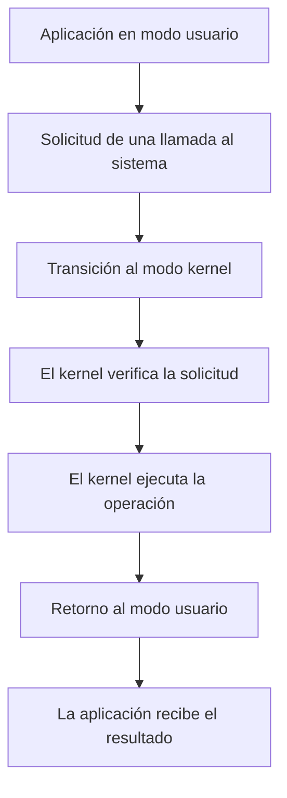

# Llamadas al Sistema (System Calls)

## 1. ¿Qué son las llamadas al sistema?

Las llamadas al sistema, conocidas como System Calls, son mecanismos que permiten a los programas solicitar servicios al núcleo del sistema operativo.

Por razones de seguridad, las aplicaciones no pueden acceder directamente a todos los recursos del hardware.

Por ello, utilizan llamadas al sistema para realizar operaciones que requieren la intervención del kernel.

## 2. ¿Para qué sirven?

Las llamadas al sistema permiten realizar diferentes operaciones:

- Crear y finalizar procesos.
- Abrir y cerrar archivos.
- Leer y escribir información.
- Administrar recursos del sistema.
- Comunicarse con dispositivos.
- Establecer comunicación entre procesos.

## 3. Funcionamiento de una llamada al sistema

El proceso general es el siguiente:

1. Una aplicación necesita realizar una operación.
2. El programa solicita un servicio mediante una llamada al sistema.
3. El procesador cambia del modo usuario al modo kernel.
4. El núcleo verifica y procesa la solicitud.
5. El sistema devuelve el resultado a la aplicación.

### Diagrama del funcionamiento

El siguiente diagrama representa cómo una aplicación solicita un servicio al núcleo del sistema operativo.



### Explicación del diagrama

1. La aplicación necesita realizar una operación.
2. Solicita un servicio mediante una llamada al sistema.
3. El procesador transfiere el control al kernel.
4. El kernel verifica los parámetros y permisos necesarios.
5. El sistema operativo ejecuta la operación solicitada.
6. El control regresa al modo usuario.
7. La aplicación continúa su ejecución con el resultado obtenido.

## 4. Modo Usuario y Modo Kernel

### Modo Usuario

Es el modo en el que normalmente se ejecutan las aplicaciones.

Tiene restricciones para proteger los recursos del sistema.

### Modo Kernel

Es un modo privilegiado que permite al sistema operativo ejecutar instrucciones protegidas y administrar recursos del hardware.

### Diferencias

| Característica | Modo Usuario | Modo Kernel |
|---|---|---|
| Privilegios | Limitados | Elevados |
| Acceso al hardware | Restringido | Privilegiado |
| Ejecución | Aplicaciones | Núcleo del sistema |
| Seguridad | Aislamiento de procesos | Control de recursos |

## 5. Ejemplos de llamadas al sistema en Linux

Linux proporciona diferentes llamadas al sistema.

### open()

Permite abrir un archivo.

### read()

Permite leer información desde un descriptor de archivo.

### write()

Permite escribir información.

### close()

Permite cerrar un descriptor de archivo.

### fork()

Permite crear un proceso hijo.

### execve()

Permite ejecutar un programa reemplazando la imagen del proceso actual.

## 6. Ejemplo práctico en Linux

Podemos utilizar Python para escribir información en un archivo.

```python
with open("ejemplo.txt", "w") as archivo:
    archivo.write("Hola desde Linux")
