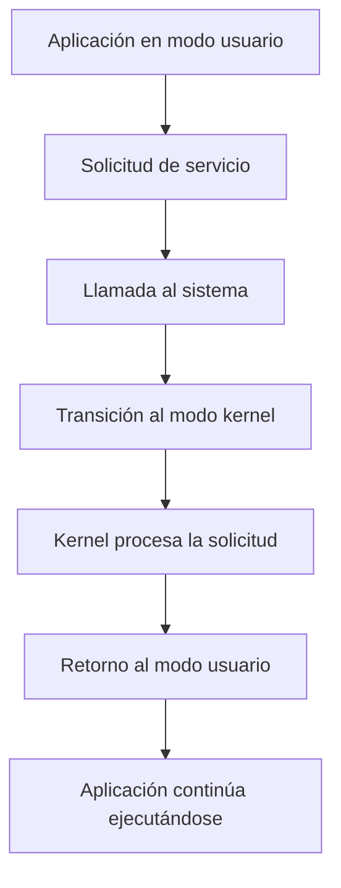

# Protección del Sistema Operativo

## 1. Introducción

La protección es una de las funciones fundamentales de un sistema operativo.

Su objetivo es controlar el acceso a los recursos de la computadora y evitar que los programas realicen operaciones que puedan comprometer el funcionamiento del sistema.

Los sistemas operativos modernos utilizan diferentes mecanismos de protección, como los niveles de privilegio, las llamadas al sistema y el aislamiento de memoria.

## 2. ¿Qué es el modo usuario?

El modo usuario es un nivel de ejecución con privilegios limitados.

En este modo se ejecutan normalmente las aplicaciones, como navegadores, editores de texto y programas desarrollados por los usuarios.

### Características

- Tiene acceso restringido a recursos protegidos.
- No puede ejecutar directamente instrucciones privilegiadas.
- Utiliza llamadas al sistema para solicitar servicios al kernel.
- Ayuda a mantener el aislamiento entre procesos.

### Ejemplo en Ubuntu

Cuando abrimos Firefox, sus procesos normalmente ejecutan código en modo usuario.

Si el navegador necesita acceder a un archivo, utiliza servicios del sistema operativo.

## 3. ¿Qué es el modo kernel?

El modo kernel es un nivel de ejecución privilegiado que permite al núcleo del sistema operativo administrar los recursos del hardware.

En este modo se ejecutan las operaciones que requieren privilegios elevados.

### Características

- Permite ejecutar instrucciones privilegiadas.
- Administra recursos del hardware.
- Controla procesos y memoria.
- Atiende llamadas al sistema e interrupciones.
- Implementa mecanismos de protección.

### Ejemplo

Cuando una aplicación solicita leer información de un archivo, el kernel interviene para procesar la operación mediante los mecanismos correspondientes.

## 4. Diferencias entre modo usuario y modo kernel

| Característica | Modo Usuario | Modo Kernel |
|---|---|---|
| Privilegios | Limitados | Elevados |
| Ejecución habitual | Aplicaciones | Núcleo del sistema |
| Acceso al hardware | Restringido | Privilegiado |
| Instrucciones protegidas | No permitidas | Permitidas |
| Seguridad | Aislamiento de aplicaciones | Control de recursos |

## 5. Diagrama de los modos de ejecución

El siguiente diagrama representa la comunicación entre una aplicación y el kernel.



## 6. ¿Qué son las interrupciones?

Las interrupciones son mecanismos que permiten notificar al procesador que existe un evento que necesita atención.

Pueden originarse por dispositivos de hardware o por determinados eventos del sistema.

Cuando ocurre una interrupción, el procesador puede suspender temporalmente la ejecución normal para atender el evento.

### Ejemplo

Cuando un dispositivo de almacenamiento finaliza una operación, puede generar una interrupción para informar al sistema operativo.

## 7. ¿Qué son las traps?

Las traps son eventos síncronos que provocan una transferencia de control hacia un manejador del sistema.

Pueden estar relacionadas con excepciones o mecanismos de entrada controlada al kernel, dependiendo de la arquitectura.

### Ejemplo

Una instrucción que provoca una excepción puede transferir el control a un manejador del sistema operativo.

En arquitecturas modernas, las llamadas al sistema pueden utilizar instrucciones específicas para realizar una transición controlada al kernel.

## 8. Diferencias entre interrupciones y traps

| Característica | Interrupciones de hardware | Traps |
|---|---|---|
| Origen | Eventos de dispositivos | Ejecución de instrucciones |
| Relación con el programa | Generalmente asíncrona | Síncrona |
| Ejemplo | Finalización de una operación de E/S | Excepción o entrada controlada al kernel |
| Atención | Manejador de interrupciones | Manejador correspondiente |

## 9. Mecanismos de protección

Los sistemas operativos utilizan diferentes mecanismos para proteger los recursos.

### Separación de privilegios

Impide que las aplicaciones ejecuten directamente determinadas operaciones reservadas al kernel.

### Protección de memoria

Controla el acceso a las regiones de memoria y ayuda a evitar que un proceso acceda a espacios no autorizados.

### Permisos de archivos

Permite establecer qué usuarios pueden leer, modificar o ejecutar archivos.

### Aislamiento de procesos

Ayuda a impedir que un proceso interfiera directamente con la memoria y los recursos protegidos de otro.

## 10. Ejemplo práctico en Ubuntu

Podemos observar los permisos de los archivos utilizando la terminal.

Ejecutamos:

```bash
ls -l
```

Este comando muestra información sobre los permisos, propietarios y grupos de los archivos.

Un ejemplo de permisos es:

```text
-rw-r--r--
```

Esto significa:

- El propietario puede leer y escribir.
- El grupo puede leer.
- Los demás usuarios pueden leer.

También podemos consultar nuestra identidad de usuario:

```bash
whoami
```

Y observar nuestros grupos:

```bash
groups
```

Estos comandos permiten explorar algunos mecanismos de control de acceso utilizados en Linux.

## 11. Importancia de la protección

Los mecanismos de protección ayudan a mantener la seguridad y estabilidad del sistema operativo.

Permiten controlar el acceso a los recursos, limitar operaciones privilegiadas y reducir las consecuencias de determinados errores en las aplicaciones.

## 12. Resumen

El modo usuario y el modo kernel permiten separar las aplicaciones de las operaciones privilegiadas.

Las interrupciones y las traps proporcionan mecanismos para atender eventos y transferir el control hacia los manejadores correspondientes.

Estos conceptos son fundamentales para comprender la seguridad y el funcionamiento interno de los sistemas operativos.

## 13. Preguntas de repaso

1. ¿Qué es el modo usuario?
2. ¿Qué es el modo kernel?
3. ¿Por qué las aplicaciones utilizan llamadas al sistema?
4. ¿Qué es una interrupción?
5. ¿Qué diferencia existe entre una interrupción de hardware y una trap?
6. ¿Qué mecanismos utiliza Linux para proteger los recursos?
