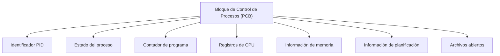

# Bloque de Control de Procesos (PCB)

## 1. ¿Qué es el PCB?

El Bloque de Control de Procesos, conocido como PCB (Process Control Block), es una estructura de datos utilizada por el sistema operativo para almacenar información relacionada con un proceso.

Cada proceso tiene información de control que permite al sistema operativo identificarlo, administrarlo y controlar su ejecución.

El PCB contiene datos importantes como el identificador del proceso, su estado, registros del procesador y recursos utilizados.

## 2. ¿Para qué sirve el PCB?

El PCB permite que el sistema operativo mantenga un registro de los procesos.

Entre sus principales funciones encontramos:

- Identificar cada proceso.
- Almacenar su estado actual.
- Guardar información del procesador.
- Administrar recursos asignados.
- Facilitar los cambios de contexto.
- Controlar la planificación de procesos.

## 3. Componentes principales del PCB

### 3.1. Identificador del proceso (PID)

Es un número que permite identificar un proceso dentro del sistema operativo.

Por ejemplo:

```text
PID: 2456
```

### 3.2. Estado del proceso

Indica la situación en la que se encuentra el proceso.

Puede representar estados como:

- Nuevo.
- Listo.
- Ejecución.
- Bloqueado.
- Terminado.

### 3.3. Contador de programa

El contador de programa almacena información sobre la próxima instrucción que debe ejecutar el procesador.

Esta información es importante para continuar la ejecución de un proceso después de una interrupción.

### 3.4. Registros del procesador

Los registros almacenan información utilizada durante la ejecución de instrucciones.

Cuando ocurre un cambio de contexto, el sistema operativo puede guardar y restaurar valores de los registros.

### 3.5. Información de memoria

El sistema operativo mantiene información relacionada con el espacio de memoria utilizado por el proceso.

Esto permite administrar y proteger los recursos de memoria.

### 3.6. Información de planificación

Incluye datos utilizados por el planificador de procesos.

Por ejemplo:

- Prioridad del proceso.
- Estado de planificación.
- Información sobre el uso del procesador.

### 3.7. Archivos abiertos

El sistema operativo mantiene referencias a los archivos y otros recursos que utiliza el proceso.

Esta información permite administrar operaciones de entrada y salida.

## 4. Diagrama de un PCB

El siguiente diagrama representa de forma simplificada los principales campos de un Bloque de Control de Procesos.



**Nota:** Este diagrama es una representación conceptual. La implementación real de las estructuras de control depende del sistema operativo.

## 5. Ejemplo de información de un PCB

Supongamos que el sistema operativo administra un proceso con los siguientes datos:

| Campo | Valor de ejemplo |
|---|---|
| PID | 2456 |
| Nombre | ProgramaCalculadora |
| Estado | Listo |
| Prioridad | 5 |
| Contador de programa | 0x00401000 |
| Memoria utilizada | 64 MB |
| Archivos abiertos | datos.txt |

Los valores anteriores son ilustrativos y no corresponden a un proceso real.

## 6. Relación entre el PCB y el cambio de contexto

Cuando el sistema operativo necesita cambiar de un proceso a otro, debe conservar la información necesaria para continuar su ejecución posteriormente.

El cambio de contexto puede incluir las siguientes operaciones:

1. Interrumpir temporalmente la ejecución del proceso actual.
2. Guardar su contexto de ejecución.
3. Actualizar la información de control del proceso.
4. Seleccionar otro proceso.
5. Restaurar el contexto del proceso seleccionado.
6. Continuar su ejecución.

El PCB y las estructuras relacionadas permiten administrar esta información.

## 7. Ejemplo práctico en Ubuntu

Linux permite consultar información de los procesos mediante diferentes comandos.

### Consultar procesos

Ejecutamos:

```bash
ps aux
```

Este comando muestra información sobre los procesos activos.

### Consultar un proceso específico

Podemos utilizar:

```bash
ps -p $$ -o pid,ppid,stat,comm
```

Este comando muestra información del proceso correspondiente al shell actual.

Los campos representan:

| Campo | Significado |
|---|---|
| PID | Identificador del proceso |
| PPID | Identificador del proceso padre |
| STAT | Estado del proceso |
| COMMAND | Nombre del comando |

### Consultar información mediante /proc

Linux proporciona información de los procesos mediante el sistema de archivos virtual `/proc`.

Podemos ejecutar:

```bash
cat /proc/self/status
```

Este comando muestra información del proceso que ejecuta `cat`.

**Importante:** Estos comandos permiten observar información de procesos, pero no muestran directamente un PCB completo.

En Linux, la estructura `task_struct` contiene información fundamental para administrar tareas y procesos.

## 8. Importancia del PCB

El PCB es fundamental para la administración de procesos.

Permite al sistema operativo conservar información de control y facilita operaciones como la planificación, la suspensión y la reanudación de procesos.

Sin estructuras de control equivalentes, el sistema operativo no podría administrar correctamente múltiples procesos.

## 9. Resumen

El Bloque de Control de Procesos es una estructura utilizada para almacenar información necesaria para administrar un proceso.

Entre sus campos principales encontramos el PID, estado, registros, contador de programa, información de memoria y recursos utilizados.

También desempeña un papel importante en los cambios de contexto.

## 10. Preguntas de repaso

1. ¿Qué significa PCB?
2. ¿Para qué sirve el Bloque de Control de Procesos?
3. ¿Qué información almacena?
4. ¿Qué función cumple el contador de programa?
5. ¿Qué relación existe entre el PCB y el cambio de contexto?
6. ¿Qué es la estructura task_struct en Linux?
