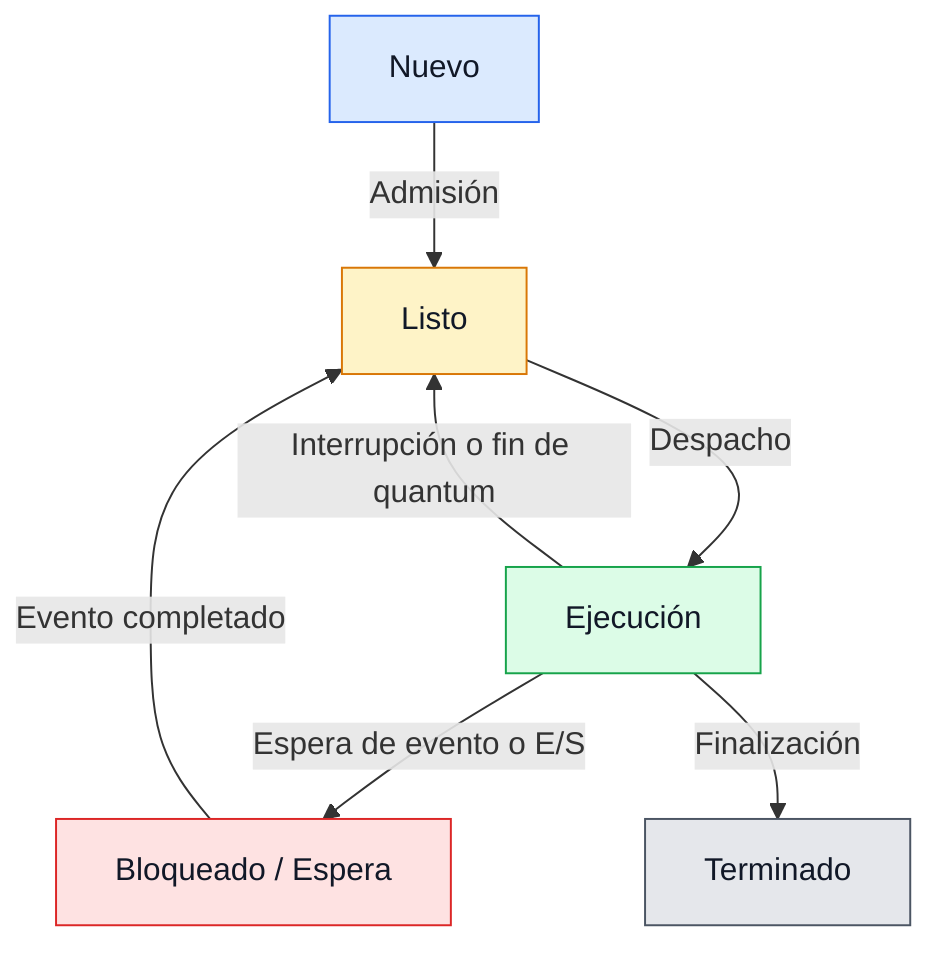

# Estados de un Proceso

## 1. ¿Qué son los estados de un proceso?

Los estados de un proceso representan las diferentes situaciones en las que puede encontrarse un proceso durante su ciclo de vida.

El sistema operativo utiliza estos estados para organizar la ejecución de los procesos y administrar los recursos disponibles.

Un proceso puede estar esperando recursos, utilizando el procesador o esperando una operación de entrada y salida.

## 2. Estados principales de un proceso

En el modelo clásico de cinco estados encontramos:

- Nuevo.
- Listo.
- Ejecución.
- Bloqueado o Espera.
- Terminado.

### 2.1. Estado Nuevo

Un proceso se encuentra en estado Nuevo cuando está siendo creado por el sistema operativo.

Durante esta etapa se preparan las estructuras necesarias para su administración.

**Ejemplo:**

Cuando ejecutamos una aplicación, el sistema operativo comienza a preparar su proceso.

### 2.2. Estado Listo

Un proceso se encuentra en estado Listo cuando tiene los recursos necesarios para ejecutarse, pero está esperando que el planificador le asigne tiempo de CPU.

**Ejemplo:**

Un programa está preparado para ejecutarse, pero el procesador está atendiendo otro proceso.

### 2.3. Estado Ejecución

Un proceso se encuentra en estado Ejecución cuando sus instrucciones están siendo ejecutadas por el procesador.

**Ejemplo:**

Un programa está realizando operaciones matemáticas utilizando la CPU.

### 2.4. Estado Bloqueado o Espera

Un proceso se encuentra bloqueado cuando necesita esperar un evento antes de continuar su ejecución.

Generalmente ocurre durante operaciones de entrada y salida.

**Ejemplo:**

Un programa solicita leer información desde un dispositivo y debe esperar a que la operación termine.

### 2.5. Estado Terminado

Un proceso llega al estado Terminado cuando finaliza su ejecución o es finalizado por el sistema operativo.

Después de esto, el sistema libera los recursos correspondientes, aunque puede conservar temporalmente cierta información de control.

**Ejemplo:**

Cuando cerramos una aplicación, sus procesos pueden finalizar.

## 3. Diagrama de estados de un proceso

El siguiente diagrama representa el ciclo de vida clásico de un proceso.



## 4. Transiciones entre estados

Los procesos cambian de estado dependiendo de los eventos que ocurren durante su ejecución.

| Transición | Descripción |
|---|---|
| Nuevo → Listo | El proceso es admitido para su ejecución. |
| Listo → Ejecución | El planificador asigna el procesador. |
| Ejecución → Listo | El proceso pierde la CPU por una interrupción o finalización del quantum. |
| Ejecución → Bloqueado | El proceso debe esperar un evento. |
| Bloqueado → Listo | El evento esperado se completa. |
| Ejecución → Terminado | El proceso finaliza su ejecución. |

## 5. ¿Qué es el planificador de procesos?

El planificador es un componente del sistema operativo encargado de seleccionar qué proceso utilizará el procesador.

Su objetivo es administrar eficientemente el tiempo de CPU.

Entre los algoritmos de planificación encontramos:

- FCFS (First Come, First Served).
- SJF (Shortest Job First).
- Round Robin.
- Planificación por prioridades.

## 6. ¿Qué es el quantum?

El quantum es el intervalo máximo de tiempo que un proceso puede utilizar la CPU antes de ser interrumpido por el planificador en algoritmos como Round Robin.

### Ejemplo

Supongamos que tenemos tres procesos:

| Proceso | Tiempo de CPU requerido |
|---|---|
| P1 | 8 ms |
| P2 | 5 ms |
| P3 | 3 ms |

Si utilizamos Round Robin con un quantum de 2 ms, cada proceso recibirá hasta 2 ms de CPU por turno.

Si todavía necesita tiempo de procesamiento, regresará a la cola de procesos listos.

## 7. Ejemplo práctico en Ubuntu

Linux permite observar el estado de los procesos utilizando comandos de terminal.

### Comando ps

Ejecutamos:

```bash
ps -eo pid,comm,state
```

Este comando muestra:

- PID: identificador del proceso.
- COMMAND: nombre del comando.
- S: estado del proceso.

### Estados comunes en Linux

| Código | Significado |
|---|---|
| R | Ejecutándose o listo para ejecutarse. |
| S | Espera interrumpible. |
| D | Espera no interrumpible. |
| T | Detenido. |
| Z | Proceso zombi. |
| I | Hilo del kernel inactivo, cuando corresponde. |

**Nota:** Los estados mostrados por Linux no corresponden exactamente al modelo teórico de cinco estados.

## 8. Importancia de los estados

Los estados permiten que el sistema operativo organice los procesos y aproveche los recursos disponibles.

Gracias a ellos, el sistema puede identificar qué procesos están preparados para ejecutarse, cuáles necesitan esperar y cuáles han terminado.

## 9. Resumen

Los procesos atraviesan diferentes estados durante su ciclo de vida.

El modelo clásico incluye Nuevo, Listo, Ejecución, Bloqueado y Terminado.

Las transiciones entre estados permiten organizar la planificación y ejecución de procesos.

## 10. Preguntas de repaso

1. ¿Qué son los estados de un proceso?
2. ¿Cuáles son los cinco estados principales?
3. ¿Qué diferencia existe entre Listo y Ejecución?
4. ¿Cuándo un proceso pasa al estado Bloqueado?
5. ¿Qué es el quantum?
6. ¿Qué función cumple el planificador?
