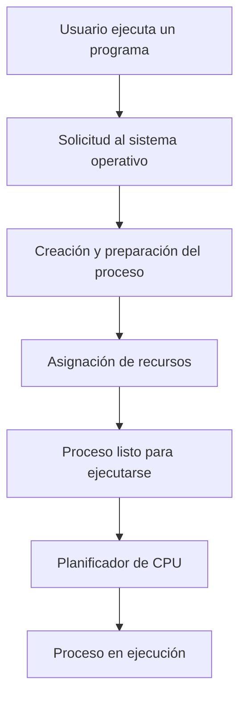

# Unidad 2: Definición y Control de Procesos

## 1. ¿Qué es un proceso?

Un proceso es un programa que se encuentra en ejecución.

Cuando ejecutamos una aplicación, el sistema operativo crea un proceso y le asigna los recursos necesarios para funcionar.

Estos recursos pueden incluir memoria, tiempo de procesador y acceso a archivos.

### Ejemplo

Cuando abrimos Firefox en Ubuntu, el sistema operativo crea procesos para ejecutar el navegador.

Cada proceso tiene información que permite al sistema operativo identificarlo y administrarlo.

## 2. Diferencia entre programa y proceso

Aunque están relacionados, un programa y un proceso no son lo mismo.

### Programa

Un programa es un conjunto de instrucciones almacenadas en un archivo.

Por sí solo, no está ejecutándose.

### Proceso

Un proceso es una instancia de un programa que está siendo ejecutada y administrada por el sistema operativo.

### Cuadro comparativo

| Característica | Programa | Proceso |
|---|---|---|
| Definición | Conjunto de instrucciones | Programa en ejecución |
| Estado | Pasivo | Activo |
| Recursos | Archivo almacenado | Utiliza memoria y otros recursos |
| Identificación | Nombre o ruta del archivo | Identificador PID |
| Ejemplo | Archivo de un programa | Aplicación ejecutándose |

## 3. ¿Qué es el PID?

El PID (Process Identifier) es un número que identifica a un proceso dentro del sistema operativo.

Linux utiliza identificadores para administrar y diferenciar los procesos.

### Ejemplo

Un proceso puede tener el siguiente identificador:

```text
PID: 2456
```

Este número es un ejemplo. El PID real depende de los procesos que estén ejecutándose.

## 4. ¿Cómo se crea un proceso?

Cuando un usuario ejecuta un programa, el sistema operativo utiliza mecanismos para iniciar su ejecución.

En sistemas tipo Unix, como Linux, es común utilizar mecanismos relacionados con fork() y execve().

### Funcionamiento general

1. Se solicita la ejecución de un programa.
2. El sistema operativo prepara los recursos necesarios.
3. Se establece el contexto de ejecución.
4. El proceso entra en los estados correspondientes.
5. El planificador determina cuándo puede utilizar la CPU.

## 5. Diagrama de creación de un proceso



Este diagrama representa de forma simplificada cómo se prepara y ejecuta un proceso.

## 6. Recursos utilizados por un proceso

Un proceso puede utilizar diferentes recursos.

### Memoria

Almacena instrucciones, datos y estructuras necesarias para la ejecución.

### Procesador

Ejecuta las instrucciones del proceso.

### Archivos

Permite leer y escribir información.

### Dispositivos

Permite realizar operaciones de entrada y salida.

## 7. Administración de procesos

El sistema operativo administra los procesos para garantizar que puedan ejecutarse de forma organizada.

Entre sus responsabilidades se encuentran:

- Crear procesos.
- Asignar tiempo de CPU.
- Controlar sus estados.
- Administrar recursos.
- Coordinar su ejecución.
- Finalizar procesos.
- Liberar recursos cuando corresponde.

## 8. Ejemplo práctico en Ubuntu

Linux proporciona comandos que permiten observar los procesos.

### Comando ps

Ejecutamos:

```bash
ps aux
```

Este comando muestra información sobre los procesos.

Algunas columnas importantes son:

| Columna | Significado |
|---|---|
| USER | Usuario propietario |
| PID | Identificador del proceso |
| %CPU | Porcentaje de CPU |
| %MEM | Porcentaje de memoria |
| COMMAND | Comando asociado al proceso |

### Comando top

Ejecutamos:

```bash
top
```

Este comando permite observar dinámicamente los procesos y su consumo de recursos.

Para salir presionamos:

```text
q
```

### Consultar el PID de nuestra terminal

Ejecutamos:

```bash
echo $$
```

Este comando muestra el PID del shell actual.

## 9. Importancia de los procesos

Los procesos permiten que un sistema operativo administre la ejecución de diferentes aplicaciones.

Gracias a ellos, podemos utilizar un navegador, escuchar música y trabajar con otros programas mientras el sistema operativo organiza el uso de los recursos.

## 10. Resumen

Un proceso es una instancia de un programa en ejecución.

Cada proceso posee información de control y utiliza recursos administrados por el sistema operativo.

Comprender los procesos es fundamental para estudiar la planificación de CPU, los hilos, la concurrencia y la sincronización.

## 11. Preguntas de repaso

1. ¿Qué es un proceso?
2. ¿Cuál es la diferencia entre programa y proceso?
3. ¿Qué significa PID?
4. ¿Qué recursos utiliza un proceso?
5. ¿Para qué sirve el comando ps aux?
6. ¿Qué función cumple el sistema operativo en la administración de procesos?
